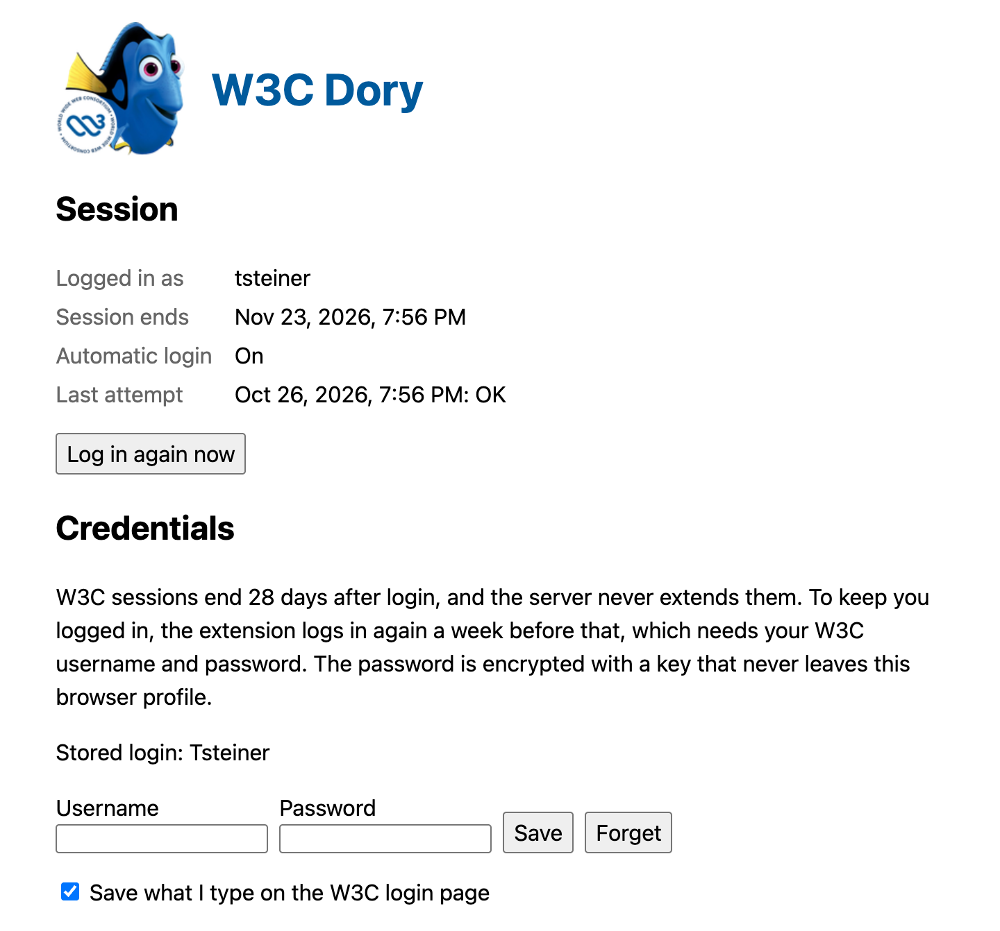

<!--
SPDX-FileCopyrightText: 2026 Thomas Steiner
SPDX-License-Identifier: Apache-2.0
-->

# W3C Dory

A Chrome extension that keeps you logged in to W3C and, after a login, takes you
to the page you were going to in the first place.

The full-resolution video is in [docs/demo.mp4](docs/demo.mp4). It shows the
same flow twice, first without and then with the extension. The meeting's
joining instructions are blurred, and the 28 days are simulated by deleting the
`w3csess` cookie.

## How W3C login works

Observed in October 2026:

1. A protected page such as `https://www.w3.org/register/…/form` redirects to
   `https://auth.w3.org/?url=<target>`. That endpoint stores `<target>` in a PHP
   session (`PHPSESSID`, a session cookie on `auth.w3.org`) and redirects to
   `/login`.
2. The login form POSTs `_username`, `_password`, and `_remember_me` to
   `/login`. On success, the server reads the target back from the PHP session
   and redirects there. There is no CSRF token.
3. The login itself is the `w3csess` cookie on `.w3.org`: the hex encoding of
   `<user>:<unix expiry>:<32-byte MAC>`. The expiry is always 28 days after
   login. With "Remember me" the cookie is persistent until then; without it, it
   is a session cookie.
4. Nothing ever re-issues `w3csess`. Pages and `auth.w3.org/loggedin` accept it
   as is, and a login POST while it is valid does not produce a new one.
5. `https://www.w3.org/account/user-menu/` returns the account as JSON when
   logged in and `[]` when not.
6. Logging out is a POST to `auth.w3.org/logout` (`single` or `all`, for all
   devices, which implies server-side revocation).
7. Login attempts are throttled: a burst of logins gets HTTP 429 for a while.

## Causes of the annoyances

**The login forgets where you were going** whenever the PHP session is missing
or stale at the moment you submit: the session timed out while the login page
sat open, the browser restarted and dropped the session cookie, or another tab
started a login in between (the last one wins). The server then sends you to the
generic "You are logged in" page.

Some login buttons never send a target at all. On event pages such as
`https://www.w3.org/events/meetings/<id>/`, "Log in to subscribe to this event"
is a `<form method="get" action="https://auth.w3.org/?url=…">`. Submitting a GET
form replaces the query of its `action` with the form's fields, so the browser
requests a bare `https://auth.w3.org/?` and the target is gone before the login
page loads. The header's "Sign in" link on the login page itself points at
`auth.w3.org/?url=https://auth.w3.org/login`, and it uses `encodeURI()`, which
cuts targets off at their first `&`.

**The login expires** 28 days after you logged in, no matter how often you use
it, because the expiry is signed into the token. Without "Remember me" it also
ends when the browser closes. Extending the cookie's lifetime in the browser
does not help, since the server checks the signed expiry.

## What the extension does

- Notes, per tab, where every trip to `auth.w3.org/` was headed: the `url`
  parameter when it names a W3C page, otherwise the page the tab is leaving.
  Right before you submit the login form, it requests
  `auth.w3.org/?url=<target>` again, so the server session holds this tab's
  target. If the server forgets it anyway, the tab is sent there after the
  login.
- Ticks "Remember me".
- Stores your username and password the first time you log in, either typed or
  filled in by the password manager. The password is encrypted with AES-GCM
  under a non-extractable key in the extension's IndexedDB. Chrome has no
  extension API to read the password manager, so on a login page with nothing
  stored the extension asks for the site's saved password through the Credential
  Management API (`navigator.credentials.get()`).
- Checks every 6 hours and logs in again in the background once the token has
  less than 7 days left or is missing. It sets the old token aside for that and
  puts it back if the login fails, so a failed renewal never logs you out.
- With stored credentials, a login page only flashes by: the background logs in
  and sends the tab on to its target.
- Pauses all of this after you log out, until you log in again or click "Log in
  again now" in the options.

Accounts with a second factor cannot be renewed in the background. The options
page says so, and the login page then works as usual.

## Install

Load this folder as an unpacked extension at `chrome://extensions`. Click the
toolbar icon for the status and the stored login.

<picture>
  <source media="(prefers-color-scheme: dark)" srcset="docs/options-dark.png">
  
</picture>

## Icon

The icon combines Dory from _Finding Nemo_ (© Disney/Pixar) with the W3C logo (®
W3C). Dory comes from
[Wikipedia's copy of the image](<https://en.wikipedia.org/wiki/File:Dory_(Finding_Nemo).png>),
and it is used here under fair use, as a small, non-commercial nod to Dory's
famously short memory, which is the problem this extension solves. Dory and her
likeness are the property of Disney and Pixar (The Walt Disney Company). The W3C
logo is the property of the World Wide Web Consortium. This project is not
affiliated with or endorsed by Disney, Pixar, or W3C.
